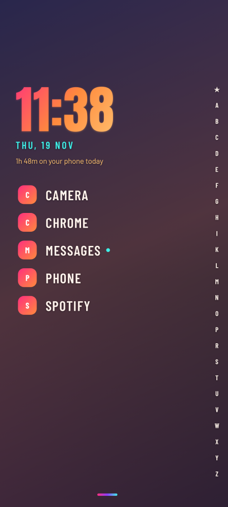
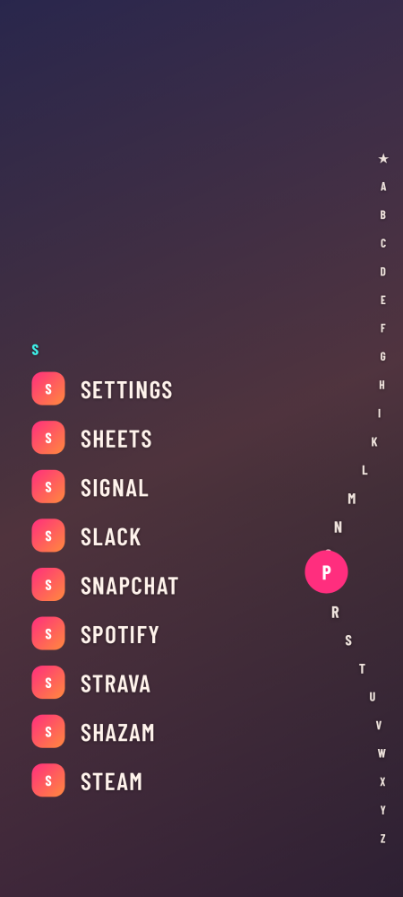
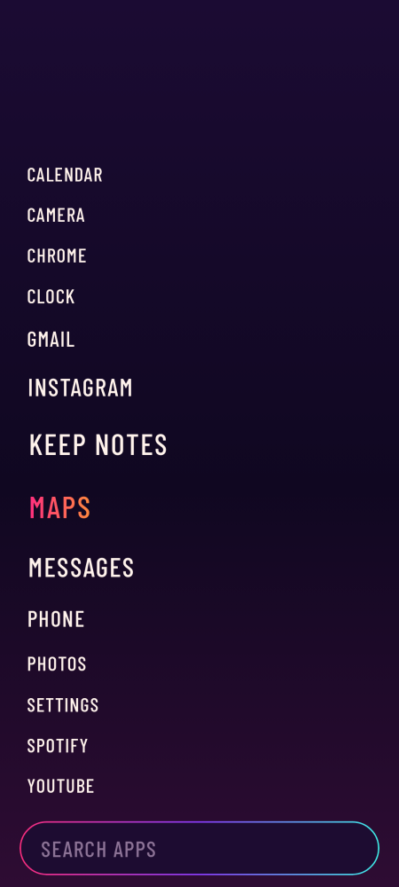

# Unscroll

A calm, minimalist Android launcher that makes your phone a tool again instead of a slot machine.

<p>
  
  
  
  
</p>

## What it does

- **A quiet home screen.** A clock, today's screen time, and up to seven favorite apps right below it. No badges, widgets, or feeds.
- **A wave alphabet on home.** A thin A–Z strip runs along the edge of the home screen. Touch it and the letters bulge out in a wave around your thumb, with the current letter in a lit bubble. That letter's apps appear beside your thumb, so you can reach any app without opening the app list. ★ at the top goes back to your favorites, and tapping empty space or pressing Back does too.
- **Themed icons.** Each app's one-color glyph (Android 13+ themed icons) sits on a small accent tile. Apps without a glyph show their initial. You can switch to full-color or gray icons, or turn icons off.
- **One-hand friendly.** Everything is a thumb-slide along the screen edge, on whichever side you choose. In the app list, the search box is at the bottom, and the best match lands right above it.
- **A Dock-style app list that never scrolls.** Every app fits on screen, packed toward your thumb.
  - Slide your thumb along the A–Z rail on the right edge, or the left edge if you choose that in Settings. The apps beside it magnify like the macOS Dock: they grow, their icons fade in, and they pop out toward the center. The current letter rides with your thumb, and a haptic tick plays as you pass each app.
  - Lift to open the highlighted app, hold still to open its menu, or slide off the list to cancel. Tap any readable app in the list to open it directly.
  - With a long app list, the resting view becomes a compact stack of bars, and magnification makes the area by your thumb readable.
  - Set the strength with the Magnification slider in Settings. Tap the search box to type instead, or have the keyboard open automatically.
- **Mindful pause.** Opening an app you've marked as distracting starts a short breathing countdown (5–30 s) that shows how often you've opened it today and how long you've spent in it. "Not now" is the big button.
- **Adaptive notifications.** Pinned apps get a small dot when they have notifications. Distracting apps never do, and you can have their notifications held back and delivered together every hour or every 3 hours. Calls, alarms and reminders always come through.
- **Two themes.**
  - **Sunset** (default): a neon dusk palette with hot pink to orange gradients, deep violet nights and aqua highlights. It uses the bold condensed Anton and Barlow fonts in a game-menu style.
  - **Classic**: quiet, Pixel-like minimalism with Material You accent colors taken from your wallpaper (Android 12+).
  - Either theme can show your wallpaper clear or dimmed, or hide it behind a solid background.
- **Customizable.** Icons can be themed, gray, in color, or off. You can rename apps and hide apps. Five gestures (swipe up, down, left and right, and double-tap) can each open the app list, notifications or quick settings, lock the screen, or open any app.

Social and video apps such as Instagram, TikTok, YouTube, X, Reddit and Snapchat are marked as distracting on first run if you have them installed. Long-press any app to change that.

## Controls

| On the home screen | Default |
| --- | --- |
| Slide along the A–Z strip | Show apps for that letter |
| Swipe up | App list |
| Swipe down | Notifications |
| Double tap | Lock screen |
| Swipe left or right | Nothing (you can set these) |
| Long press on empty space | Unscroll settings |
| Tap the clock | Alarms |
| Long press an app | Pin, reorder, distracting, rename, hide, info, uninstall |

In the app list, slide along the A–Z rail and lift to open an app, or tap any readable app. Tap empty space or press Back to close it.

## Install on your phone

**Option A: Android Studio**

1. Open this folder in Android Studio and let it sync.
2. Pick the `release` build variant (Build > Select Build Variant) so it runs smoothly. Debug Compose builds are noticeably janky.
3. Plug in your phone with USB debugging on and press Run.

**Option B: command line** (JDK 17+ and the Android SDK installed)

```bash
./gradlew assembleRelease
```

```bash
adb install -r app/build/outputs/apk/release/app-release.apk
```

The release build is signed with your local debug key so you can sideload it without setting up a keystore.

**Then make it your home screen.** Open Unscroll, long-press empty space, and tap *Make Unscroll your home screen*. You can also go to Android Settings > Apps > Default apps > Home app.

## Optional permissions

Unscroll works without any of these. Each one switches on a feature, and you're asked from Settings only when you turn that feature on.

| Permission | Enables |
| --- | --- |
| Usage access | Screen time on the home screen and in the pause screen |
| Notification access | Notification dots and batching for distracting apps |
| Accessibility ("Unscroll lock gesture") | Locking the screen with a gesture (Android 9+). It reads nothing on screen. |

Everything stays on your phone. Unscroll has no internet permission.

## Limits

A launcher only controls what you open *from it*. Opening a distracting app from a notification, from Recents or from a share sheet skips the pause. That's a deliberate trade-off to avoid needing invasive permissions.

## Project layout

```
app/src/main/java/dev/unscroll/launcher/
├── MainActivity.kt          the HOME activity
├── LauncherViewModel.kt     app list, settings, pause flow, gestures
├── data/                    apps, preferences, screen-time calculation
├── system/                  notification listener, lock service, status bar helpers
└── ui/                      Compose screens: home, app list, pause, long-press sheet, settings
```

Kotlin, Jetpack Compose, Material 3. Min Android 8.0 (API 26), target API 35.

## Credits

The Sunset theme uses [Anton](https://fonts.google.com/specimen/Anton) and [Barlow](https://fonts.google.com/specimen/Barlow) / [Barlow Condensed](https://fonts.google.com/specimen/Barlow+Condensed). Both are licensed under the SIL Open Font License 1.1, and the license texts are in `third_party/fonts/`.
