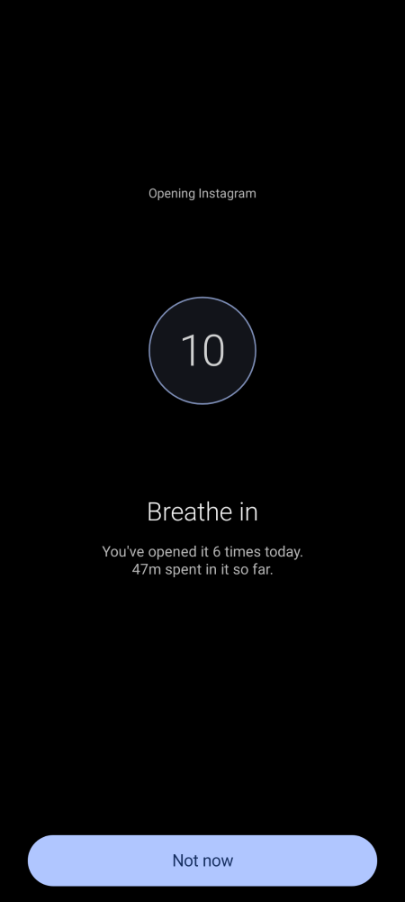

# Unscroll

A calm, minimalist Android launcher that makes your phone a tool again instead of a slot machine.

<p>
  
  
  
</p>

## What it does

- **A quiet home screen.** A clock, today's screen time, and up to seven apps as plain text. No icons (unless you want them), badges, widgets, or feeds.
- **One-hand friendly.** Your apps sit in the lower half of the screen. In the app list, the search box is at the bottom, and the best match lands right above it.
- **Search first.** Swipe up and the keyboard is already open. You type what you came for instead of browsing. Press Enter to open the top match.
- **Mindful pause.** Opening an app you've marked as distracting starts a short breathing countdown (5–30 s) that shows how often you've opened it today and how long you've spent in it. "Not now" is the big button.
- **Adaptive notifications.** Pinned apps get a small dot when they have notifications. Distracting apps never do, and you can have their notifications held back and delivered together every hour or every 3 hours. Calls, alarms and reminders always come through.
- **Pixel-like look.** Material You accent colors taken from your wallpaper (Android 12+), with the wallpaper shown clear, dimmed, or replaced by pure black.
- **Customizable.** Icons can be off, grayscale or in color. You can rename apps and hide apps. Five gestures (swipe up, down, left and right, and double-tap) can each open the app list, notifications or quick settings, lock the screen, or open any app.

Social and video apps such as Instagram, TikTok, YouTube, X, Reddit and Snapchat are marked as distracting on first run if you have them installed. Long-press any app to change that.

## Controls

| On the home screen | Default |
| --- | --- |
| Swipe up | App list |
| Swipe down | Notifications |
| Double tap | Lock screen |
| Swipe left or right | Nothing (you can set these) |
| Long press on empty space | Unscroll settings |
| Tap the clock | Alarms |
| Long press an app | Pin, reorder, distracting, rename, hide, info, uninstall |

In the app list, pull down from the top to close it, or press Back.

## Install on your phone

**Option A: Android Studio**

1. Open this folder in Android Studio and let it sync.
2. Pick the `release` build variant (Build > Select Build Variant) so it runs smoothly. Debug Compose builds are noticeably janky.
3. Plug in your phone with USB debugging on and press Run.

**Option B: command line** (JDK 17+ and the Android SDK installed)

```bash
./gradlew assembleRelease
```

```bash
adb install -r app/build/outputs/apk/release/app-release.apk
```

The release build is signed with your local debug key so you can sideload it without setting up a keystore.

**Then make it your home screen.** Open Unscroll, long-press empty space, and tap *Make Unscroll your home screen*. You can also go to Android Settings > Apps > Default apps > Home app.

## Optional permissions

Unscroll works without any of these. Each one switches on a feature, and you're asked from Settings only when you turn that feature on.

| Permission | Enables |
| --- | --- |
| Usage access | Screen time on the home screen and in the pause screen |
| Notification access | Notification dots and batching for distracting apps |
| Accessibility ("Unscroll lock gesture") | Locking the screen with a gesture (Android 9+). It reads nothing on screen. |

Everything stays on your phone. Unscroll has no internet permission.

## Limits

A launcher only controls what you open *from it*. Opening a distracting app from a notification, from Recents or from a share sheet skips the pause. That's a deliberate trade-off to avoid needing invasive permissions.

## Project layout

```
app/src/main/java/dev/unscroll/launcher/
├── MainActivity.kt          the HOME activity
├── LauncherViewModel.kt     app list, settings, pause flow, gestures
├── data/                    apps, preferences, screen-time calculation
├── system/                  notification listener, lock service, status bar helpers
└── ui/                      Compose screens: home, app list, pause, long-press sheet, settings
```

Kotlin, Jetpack Compose, Material 3. Min Android 8.0 (API 26), target API 35.
